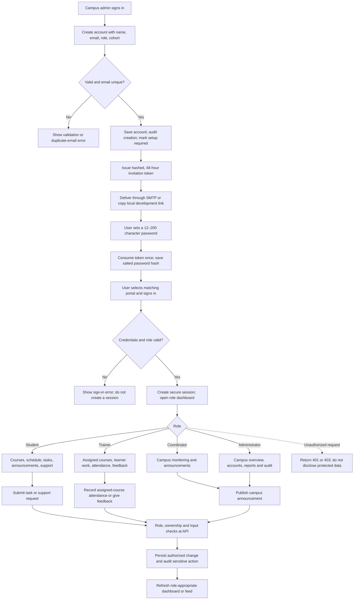

# Zyngram Campus Hub — design & application model

**Day 17 project · Design-based model with a working local prototype**

## Purpose and design rationale

Campus Hub gives a learner one welcoming home for their course, next session, tasks, progress, and campus updates. The design replaces scattered portals and messages with clear, role-specific entry points and one consistent navigation model. It favours a quiet visual hierarchy, meaningful status labels, helpful empty/error states, short forms, mobile access, and plain-language privacy cues.

The app is an executable prototype built with React, Express, and MongoDB. Account invitations, support tickets, and staff-recorded attendance are connected to local APIs. Sample records, demo access, certificates, and some schedule/progress details are illustrative. SMTP must be configured for production invitation email; the application is **not** a live learning-management service.

## Roles and access

| Role | View | Create | Update | Approve / review | Manage |
|---|---|---|---|---|---|
| **Student / candidate** | Own profile, assigned courses, sessions, attendance, tasks, feedback, progress, announcements, own support tickets, and services | Public student ZIN ID registration request; own task submission (HTTPS link and note); support ticket | Own display name and task submission while open; account role, email, and cohort remain administrator-managed | No | No other users or campus records |
| **Trainer** | Assigned courses, linked learners' submissions, attendance, and task/attendance progress | Task feedback for work in assigned courses | Review status and feedback for assigned work | Review and complete assigned-course submissions | No account, role, course, or campus configuration management |
| **Campus coordinator** | Campus courses/batches, attendance, tasks, announcements, and operations dashboard | Campus announcement; feedback on campus task list in this prototype | Announcement content before publishing; campus task feedback | Monitor campus attendance and task activity; task feedback in prototype | No user/role administration in current scope |
| **Administrator** | Campus dashboard, task oversight, attendance, reports, announcements, users, support queue, and audit log | Campus announcement; add user account; issue setup invitation | Update support-ticket status; no account editing/deactivation or system configuration in current scope | Campus-wide task feedback; inspect audit events | Add accounts, issue/reissue invitations, manage support-ticket status, and view recent audit activity; access/settings administration is future scope |

**Meaning of action boundaries:** “Review” means reviewing and optionally providing feedback; no formal grades, attendance approval, or certificate approval process is implemented. The API is authoritative for permissions; hiding a link in React is not treated as authorization. Trainers are checked against the trainer assigned to the course before task feedback, course, attendance, and progress records are returned. Students only receive their own task and attendance records. Coordinator/admin access is campus-wide and is labelled accordingly.

The navigation also reflects each role: students see personal learning, progress, services, and support; trainers see assigned courses, schedules, learner submissions, and feedback; coordinators see campus courses/batches, attendance, task monitoring, and announcements; administrators see a separate campus-wide dashboard, account management, reports, access/system overview, task oversight, and the activity log. Progress and certificates are student-only screens, not learner-facing content shown to staff. Administrator access counts are returned only to the admin dashboard. The access/system screen is intentionally read-only: permissions remain enforced in the API and deployment secrets are not editable or displayed in the browser.

The local sample catalogue assigns Priya Nair to Full Stack Web Development, Arjun Rao to Digital Marketing, and Neha Varma to Finance Fundamentals. These fictional course records demonstrate trainer-specific scoping; they are not a live course catalogue.

### Design refinements for implementation

No separate evaluator feedback was supplied with this brief. To make the Day 17 design implementation-ready, the blueprint makes the following product decisions explicit rather than implying unbuilt behavior:

- Registration is an administrator-provisioned account, not an open public sign-up. Admins issue 48-hour, single-use setup links; local development exposes a copyable link, while production requires configured SMTP delivery and an HTTPS app URL.
- Student self-registration generates a ZIN ID and saves a salted password hash with a pending request; it cannot create a login account or grant portal access. An admin reviews and approves or rejects it. Approval creates the student account, enabling sign-in with that ZIN ID and chosen password. Admin request notifications require SMTP configuration.
- The selected portal is checked against the authenticated account role. A role-specific navigation menu improves discoverability, but the API remains the permission boundary.
- Task status is expressed with both text and visual treatment; submission and review feedback have explicit success/error states. Progress and certificate visuals are identified as illustrative wherever they are not backed by a real assessment record.
- Support requests persist in MongoDB and are status-managed by admins; they do not send email or guarantee a response SLA. Staff can record attendance for a course roster inferred from assigned tasks; schedule/session dates and external campus services remain illustrative.
- Layouts support a narrow mobile viewport as well as desktop, with labelled controls, visible keyboard focus and reduced-motion behavior.

## Core modules and screens

1. **Portal landing and sign-in** — choose Student, Trainer, Campus Coordinator, or Administration. The role-specific form accepts campus email and password and verifies both credentials and selected role.
2. **Dashboard** — learning snapshot, attendance, open tasks, learning paths, announcements context, and next-session prompt; staff sees role-specific context.
3. **My learning / courses** — course cards, track, duration, progress, and continue action.
4. **Schedule & attendance** — next sessions, attendance percentage, check-in history; staff API scopes attendance to assigned courses or authorized campus views.
5. **Tasks & feedback** — task state, due date, secure project-link submission, learner note, trainer feedback, and review controls.
6. **Progress & reports** — students see their illustrative course progress, skills, milestones, and certificate states; trainers see assigned-course task completion and attendance; administrators see campus-wide task/attendance indicators.
7. **Announcements** — read campus notices; coordinators/admins can publish validated updates.
8. **Campus services and support** — career/alumni/events concepts and persistent support tickets; tickets do not trigger email delivery.
9. **Profile, user management, access/system, activity log** — personal record, admin account list/create, read-only role/runtime overview, and restricted audit view. The admin dashboard provides campus account counts and shortcuts to these controls and reports.

Reusable visual elements include a light off-white/white canvas with plum and green accents, a dark theme variant, serif display headings, compact mono overlines, course progress bars, avatars, role/status badges, icon buttons, panels, consistent button treatments, and breakpoints for mobile navigation and card layouts. Interactions retain visible labels; keyboard focus is outlined; reduced-motion settings are respected.

### Key screen designs and interaction states

The responsive React prototype and the slide deck provide the visual model. The following screen inventory makes the screen purpose and important states explicit:

| Screen | Main content and navigation | Primary action / form | Status, empty, and validation states |
|---|---|---|---|
| **1. Portal landing and sign-in** | Four role cards; role-specific sign-in form; return-to-portals action | Select Student, Trainer, Coordinator, or Administration; enter campus email and password; Sign in | Required email/password; selected-portal credential error; busy “Signing in…” state; development sample access labelled and disabled in production |
| **2. Role-aware dashboard** | Persistent role menu, welcome panel, upcoming session, course/task/attendance summary, quick links | Continue learning, view progress/task work, open schedule, notifications | Snapshot cards; loading and API error; clear empty copy for missing records; controls navigate to role-appropriate sections |
| **3. Courses / learning paths** | Course cards, track, duration, progress; staff view scoped to teaching/campus | Student: Continue learning / Explore a path. Staff: view learner work | Progress labels; empty state for no assigned courses; staff does not see student-only certificate content |
| **4. Schedule and attendance** | Upcoming-session design, recorded check-in history, attendance summary; staff scope by assigned courses or campus role | Staff selects course/date and marks roster learners present, late, or absent; export button is illustrative | Require a status for every learner; duplicate/invalid dates and non-roster learners rejected; attendance upsert is unique per learner/course/date; explicit empty/error states |
| **5. Tasks, submission, and feedback** | Task cards with due date and To do / In review / Complete status; staff review actions | Student form: HTTPS project URL (required), note (optional, 1,000 characters); staff: Leave feedback | Invalid/non-HTTPS link rejected; note length shown; sending state; empty review state; successful “In review” state; feedback visible after trainer review |
| **6. Progress and certificates / staff reports** | Student skill/progress/milestone view; trainer assigned-course report; admin campus-wide task/attendance analytics | Student: continue course or view milestone. Staff: review learner activity | Progress/certificate examples are marked illustrative; report empty state when no activity; staff records restricted to authorized scope |
| **7. Announcements** | Campus feed, audience/category, publish date | Coordinator/admin form: title, message, audience, category; Publish | Read-only for learners/trainers; server rejects unauthorized publish; required/min/max validation; load error; empty welcome state |
| **8. User management / activity log** | Admin-only user table, role/cohort/account status, recent audit entries | Add account; issue/reissue setup invitation | Duplicate email error; invitation token is hashed, single-use and expires in 48 hours; local link is copyable and production uses SMTP; empty user/log states; endpoints admin-only |
| **9. Help, profile, and campus services** | Profile/privacy summary, own support history or admin ticket queue, career/community/event concepts | Support form with topic/message; admin changes ticket status; service links are proposed connections | Ticket is persisted as open; admin may set in-progress/resolved; empty/error states; no email notification or response SLA; profile edit and external service integrations are not implemented |

### Module-wise functional specification

The API names below are the current local prototype contract. The acceptance criteria define expected behavior; items labelled future are not represented as implemented.

| Module | Roles and behavior | API / data | Acceptance criteria and verification |
|---|---|---|---|
| Account provisioning and sign-in | Admin creates accounts and issues 48-hour single-use setup links; all roles sign in through their selected portal. Public self-registration is intentionally disabled. | `POST /api/users`, `POST /api/users/:id/invite`, `POST /api/auth/accept-invite`, `POST /api/auth/login`, `POST /api/auth/logout`, `GET /api/auth/session`, `GET /api/auth/me`; `users` | Reject invalid credentials/role mismatch; invitation token stored only as SHA-256 hash; reject expired/reused links and passwords outside 12–200 characters; production requires SMTP and HTTPS app URL; never return secrets. Test invite, accept, expiry/reuse, login, duplicate and unauthorized account creation. |
| Role dashboard | Authenticated user sees only dashboard data allowed for their role. The `tasks` property is consistently an array for every role; staff records include learner names. | `GET /api/dashboard`; users, courses, tasks, attendance, announcements | Student response contains personal learning context and no campus-wide counts; trainer task records are limited to assigned courses; coordinator/admin records are campus-wide; admin summary is admin-only; empty datasets render a usable empty state. Test 401 and role-specific response shape and task scope. |
| Learning and attendance | Students see their own courses and attendance; trainers are limited to assigned courses; coordinator/admin views are campus-wide. Staff can record present/late/absent for learners with tasks assigned to that course. | `GET /api/courses`, `GET /api/attendance`, `GET /api/attendance/roster`, `POST /api/attendance`; courses, tasks, attendance | Student cannot write attendance or select another learner; trainer cannot access unassigned courses; reject non-roster learners, duplicate IDs, invalid dates/statuses; upsert unique learner/course/date and audit each submission. Test ownership and trainer boundaries. |
| Tasks and feedback | Student submits HTTPS project URL and optional note while task is open; assigned trainer or campus staff reviews and leaves feedback. | `GET /api/tasks`, `POST /api/tasks/:id/submit`, `POST /api/tasks/:id/feedback`; tasks, audit_log | Reject non-HTTPS URLs, invalid/overlong fields, closed tasks and unauthorized review; valid submission moves to `in_review`; feedback updates task and status. Test success, validation errors, ownership, course assignment and role boundaries. |
| Progress and reports | Student sees illustrative progress; trainer sees assigned learner activity; coordinator/admin see campus indicators. | `GET /api/progress`; courses, tasks, attendance | Staff data is scoped correctly; student is denied this staff report endpoint; empty reports explain missing activity; illustrative metrics are not presented as official grades. Test role gating and trainer/campus scope. |
| Announcements | All signed-in roles read; coordinator/admin publish. | `GET /api/announcements`, `POST /api/announcements`; announcements, audit_log | Required fields and length bounds are validated; publication is audited; student/trainer writes return 403. Test read access, write permission, validation and audit event. |
| Profile and campus services | User reads own profile and may create/view own support tickets; admins view campus tickets and update statuses. Profile editing and external integrations are future work. | `GET /api/profile`, `GET /api/support`, `POST /api/support`, admin-only `PATCH /api/support/:id`; users, support_tickets, audit_log | Ticket creation validates topic/message and assigns actor from session; non-admins see only their tickets; only admin changes status; changes are audited. Test authorization, isolation, validation and transitions. |
| User management and audit | Admin lists/creates accounts, issues/reissues setup links, and inspects recent audit entries. | `GET /api/users`, `POST /api/users`, `POST /api/users/:id/invite`, `GET /api/audit`; users, audit_log, SMTP | Non-admin requests are denied; setup link is hashed in storage, single-use and 48-hour; production email requires SMTP and HTTPS `APP_BASE_URL`; audit history is read-only. Test access control, token lifecycle, delivery configuration and audit events. |
| Production operations | Deployment serves the built UI and API, with secrets, SMTP and MongoDB managed outside the browser. | `GET /api/health`; MongoDB, SMTP and Render configuration | Health endpoint confirms service readiness; production requires `SESSION_SECRET`, HTTPS `APP_BASE_URL`, SMTP settings and MongoDB; demo-auth endpoints remain disabled. Smoke-test production build, startup, health check and invitation delivery. |

**Visual system:** warm off-white canvas `#f7f7f3`, plum `#6e5b80`, muted green `#65836f`, ink `#25251f`, and white panels; Playfair Display/Georgia display headings, DM Sans body text, and DM Mono overlines. Use a consistent 8px spacing rhythm, rounded panels, Lucide outline icons, visible button labels, and shared status/progress components. Colour is never the only status signal: each status also has text.

**Responsive and accessible behavior:** at narrow widths, the sidebar becomes a slide-in navigation with a close control/scrim; card grids and forms collapse to one column; minimum layout width is 320px. Use semantic landmarks, labelled inputs, browser-required validation plus server validation, visible 3px keyboard focus, announced error/status messages, adequate contrast, and reduced-motion support. No fixed mobile-only flow is required to complete sign-in, task submission, or navigation.

## Sitemap / navigation

```text
Portal landing
├── Student portal → sign-in → Student dashboard
│   ├── My learning · Schedule & attendance · Tasks & feedback
│   ├── Progress & certificates · Announcements
│   └── Campus services · Help & support · Profile
├── Trainer portal → sign-in → Teaching dashboard
│   ├── Choose trainer account → My courses · Schedule & attendance · Learner submissions
│   ├── Learner progress · Announcements · Help & support · Profile
├── Coordinator portal → sign-in → Campus operations dashboard
│   ├── Courses & batches · Campus attendance · Task monitoring
│   └── Announcements · Help & support · Profile
└── Administration portal → sign-in → Campus administration dashboard
    ├── Courses & batches · Campus attendance · Task oversight · Reports & analytics
    ├── Announcements · Help & support · Profile
    └── User management · Activity log
```

## User journeys

### End-to-end registration and service workflow

There is no public self-registration form. An administrator provisions an account and issues a single-use password setup link. In local development the link is shown to the administrator; production delivery uses SMTP and an HTTPS `APP_BASE_URL`.



### Journey 1 — learner submits work and receives feedback

```text
Student portal → authenticate → Dashboard → Tasks & feedback
→ Open task → enter HTTPS project link + optional note
→ Client and server validation → task becomes "In review"
→ Audit event saved → assigned trainer opens submission
→ Trainer enters feedback → status becomes "Complete"
→ Student sees updated status and feedback on the task
```

Invalid URLs, non-HTTPS URLs, overlong input, closed tasks, or an unauthorized role receive a clear API error; no success message is shown. Sample feedback is seeded to demonstrate the completed state.

### Journey 2 — learner checks attendance and progress

```text
Student portal → authenticate → Dashboard snapshot
→ Schedule & attendance → review next sessions and check-in history
→ Progress & certificates → view course progress and milestones
→ Profile → review personal information and privacy notice
```

Attendance records are fetched for the authenticated learner, not chosen through a client-supplied user ID. Trainers can record attendance for task-associated learners in courses assigned to them; coordinators/admins can record across courses. There is no student self-check-in, and schedule/session dates remain illustrative.

### Journey 3 — coordinator publishes a campus update

```text
Coordinator portal → authenticate → Announcements
→ New announcement → enter title, audience, category, message
→ Server validates input and role → announcement stored in MongoDB
→ Publish action audited → update appears in the campus feed
```

Students and trainers can read but cannot publish. A student publish request receives HTTP 403 even if submitted outside the interface.

### Journey 4 — administrator adds a campus account (additional)

```text
Administration portal → authenticate → User management
→ Add account → validate name, email, role, and cohort
→ Unique-email check → create account without a password
→ Record audit event → account marked "setup required"
```

The administrator can issue or reissue a one-time invitation from User management. In production, configure the SMTP connection and public HTTPS app URL. A local operator can still interactively set a salted password for a seeded sample account using `npm run set-password -- <role>`.

## High-level architecture and data flow

```text
Browser (React, responsive UI)
  │ same-origin /api calls; session cookie is HttpOnly, SameSite=Strict
  ▼
Express API
  ├── Zod request validation
  ├── Signed session verification + role/ownership/course-scope authorization
  ├── Audit events for sensitive write/auth actions
  └── Validated document queries + indexed MongoDB collections
        ▼
     MongoDB (local prototype database)
     users ──< courses ──< tasks >── users (learner)
       │          │             └── submission + trainer feedback
       │          └── attendance >── users (learner)
       ├──< support_tickets
       ├──< audit_log
       └── announcements (publisher/audience)
SMTP service <── one-time account invitation (hashed token stored in users)
```

React never supplies its own trusted actor ID. The server derives the actor from the signed, short-lived cookie. MongoDB enforces unique email and learner/course/date indexes; validated queries constrain ownership and trainer assignment. Production must use an operated MongoDB deployment, backups, retention, and campus/tenant isolation controls.

## Conceptual entity relationships

```text
USER (role: student | trainer | coordinator | admin)
  ├── student 1 ── * TASK (learner_id)
  ├── student 1 ── * ATTENDANCE (user_id)
  ├── trainer 1 ── * COURSE (trainer_id)
  ├── coordinator/admin 1 ── * ANNOUNCEMENT (publisher_id)
  └── staff user 1 ── * AUDIT_LOG (actor_id)

COURSE 1 ── * TASK
COURSE 1 ── * ATTENDANCE
TASK 1 ── 0..1 SUBMISSION (URL/note fields in prototype)
TASK 1 ── 0..* FEEDBACK / REVIEW (feedback fields in prototype)
```

Assessment rubric/attempt, batch membership, schedule/session, certificate issuance, notification delivery, and role-permission policy are future entities or integrations; current progress/certificate visuals must not be interpreted as official assessment or credential records.

## Conceptual data entities

- **User** (`_id`, `name`, `email`, `role`, `cohort`, `avatar`, `password_hash`, `invite_token_hash`, `invite_expires_at`, `credential_set_at`) — one of four roles; normalized email is unique. Password hashes use salted scrypt; invitation tokens are stored only as SHA-256 hashes and removed after successful use.
- **Course** (`_id`, `title`, `track`, `trainer_id`, `duration`, `progress`, `next_session`, `color`) — assigned trainer and learning path.
- **Attendance** (`_id`, `user_id`, `course_id`, `session_date`, `status`, `recorded_by`, `updated_at`) — staff-recorded learner status (`present`, `late`, `absent`); unique index per learner/course/date. Roster membership currently derives from learners with tasks in the course.
- **Task** (`_id`, `learner_id`, `course_id`, `title`, `due_date`, `status`, `description`, `submission_url`, `submission_note`, `feedback`, `updated_at`) — owned submission and review lifecycle.
- **Announcement** (`_id`, `title`, `body`, `audience`, `publisher_id`, `published_at`, `category`) — campus notice.
- **Support ticket** (`_id`, `user_id`, `topic`, `message`, `status`, `created_at`, `updated_at`) — private requester record; admin may set status to `open`, `in_progress`, or `resolved`.
- **Audit log** (`_id`, `actor_id`, `action`, `entity`, `entity_id`, `created_at`) — append-only application actions in this prototype.

### Implementation-oriented MongoDB schema

IDs are strings in the current prototype (including seeded IDs); do not assume MongoDB `ObjectId`. API documents expose `_id` as `id`. Fields marked optional may be absent or `null`. Calendar dates use `YYYY-MM-DD`; timestamps use ISO-8601 UTC strings except `invite_expires_at`, which is a MongoDB `Date`.

| Collection | Required fields and types | Optional fields / allowed values | References and validation |
|---|---|---|---|
| `users` | `_id: string`, `name: string`, `email: string`, `role: enum(student, trainer, coordinator, admin)` | `cohort: string`, `avatar: string`, `password_hash: string|null`, `invite_token_hash: string`, `invite_expires_at: Date`, `credential_set_at: ISO timestamp` | `email` is trimmed/lowercase and unique. Password stores `scrypt$<salt>$<digest>`, never plaintext. An invitation is valid only when its token hash matches, expiry is in the future, and `password_hash` is null. |
| `student_registration_requests` | `_id: string`, `name: string`, `email: string`, `cohort: string`, `status: enum(pending, approved, rejected)`, `created_at: ISO timestamp` | `approved_by`, `approved_at`, `rejected_by`, `rejected_at`, `user_id` | Public submissions create pending requests only. Admin-only review routes change status. Unique partial index on `email` applies to pending requests; approved accounts are stored in `users` and receive a one-time setup invitation. |
| `courses` | `_id: string`, `title: string`, `track: string`, `trainer_id: string` | `duration: string`, `progress: number`, `next_session: string`, `color: string` | `trainer_id` references a `users._id` with role `trainer`. `progress`, schedule, and visual fields are demonstration data unless backed by an approved source. |
| `tasks` | `_id: string`, `learner_id: string`, `course_id: string`, `title: string`, `due_date: YYYY-MM-DD`, `status: enum(todo, in_review, complete)`, `description: string` | `submission_url: HTTPS URL|null`, `submission_note: string`, `feedback: string|null`, `updated_at: ISO timestamp` | `learner_id` references a student; `course_id` references a course. The learner must own the task to submit. A trainer can review only when assigned to its course; campus staff have campus-wide scope. |
| `attendance` | `_id: string`, `user_id: string`, `course_id: string`, `session_date: YYYY-MM-DD`, `status: enum(present, late, absent)` | `recorded_by: string`, `updated_at: ISO timestamp` | `user_id` references a student; `course_id` references a course; `recorded_by` references the authenticated staff user. One record per learner/course/date; writes replace the status for that session. Current roster derives from task assignments, not formal enrollment. |
| `announcements` | `_id: string`, `title: string`, `body: string`, `audience: string`, `category: string`, `published_at: ISO timestamp` | `publisher_id: string` | `publisher_id` references a coordinator/admin. Audience targeting is a descriptive field in this prototype, not a fully enforced cohort-delivery system. |
| `support_tickets` | `_id: string`, `user_id: string`, `topic: enum(Learning & coursework, Schedule & attendance, Account access, Campus services, Something else)`, `message: string`, `status: enum(open, in_progress, resolved)`, `created_at: ISO timestamp` | `updated_at: ISO timestamp` | `user_id` references the requester. The server derives this ID from the session; requester reads are owner-scoped; only admins change status. |
| `audit_log` | `_id: string`, `actor_id: string`, `action: string`, `entity: string`, `entity_id: string`, `created_at: ISO timestamp` | — | Actor is derived from the session (or a documented system actor for local seed scripts). Application code appends events; there is no edit/delete API. |

**Prototype indexes:** unique `users.email`; sparse `users.invite_token_hash`; unique partial pending registration email and `student_registration_requests(status, created_at desc)`; unique `attendance(user_id, course_id, session_date)`; `tasks(learner_id, due_date)`; `tasks(course_id, learner_id)`; `support_tickets(user_id, created_at desc)`; `support_tickets(status, created_at desc)`; and `audit_log(created_at desc)`. Before production, review query plans and add indexes for course assignment, task review queues, announcement ordering, and any approved enrollment/session model; validate index changes against representative data and write load.

**Task state contract:** `todo → in_review` when the learner submits a valid HTTPS URL; a learner may resubmit while `in_review`, updating the same task submission fields. Staff feedback may leave it `in_review` or move it to `complete`. Completed tasks are closed to learner submissions. Every transition validates role, ownership/course assignment, and input on the API; student and staff dashboards consume the same task-array shape, with staff-only learner attribution.

## Data protection, validation, accessibility

- Credential login requires a valid email, a password, and a matching selected portal. The stored credential is a salted scrypt hash; session cookies are `HttpOnly`, `SameSite=Strict`, and have an eight-hour lifetime. Secure cookies are enabled in production.
- Demo login and the sample-account list are development-only and return 404 in production. Demo login intentionally bypasses passwords and must not be treated as real authentication.
- Invitation tokens are generated randomly, stored as SHA-256 digests, expire after 48 hours, are consumed once, and are never returned from user/profile APIs. Production invitation email requires SMTP configuration and HTTPS `APP_BASE_URL`.
- Role checks, learner ownership, and trainer/course assignment are enforced server-side. Password hashes are not returned from API responses.
- Inputs have client affordances and server-side Zod constraints; submissions require HTTPS, tasks must be open, duplicate account emails are rejected, and forms expose validation status.
- Security headers include `nosniff`, `DENY` frame policy, and a same-origin referrer policy. MongoDB queries use explicit filters/projections, and JSON request bodies are size-limited.
- Student record endpoints return only the signed-in learner's rows. Admin-only user and audit endpoints deny other roles.
- Use semantic landmarks, labelled inputs, status announcements, visible keyboard focus, icon labels, contrast-conscious labels, responsive layouts, and reduced-motion CSS.
- Only fictional `example.test` identities and fabricated coursework are present. Avoid real learner names, account data, passwords, tokens, and API secrets.

## Assumptions and incomplete areas

- Assumes one sample campus and a single sample cohort; course schedules and seeded dates are illustrative.
- Batch membership and batch administration are described in the role/sitemap model, but a batch entity and batch-management screens/API are not implemented.
- Development sample access is intentionally a one-click role simulator; it is not secure authentication.
- Credential login becomes usable after a local operator sets each seeded role's password. No passwords are checked into this repository.
- Newly added staff users cannot sign in until they accept an administrator-issued invitation. Student self-registration instead remains pending until an administrator approves it.
- Task submission stores a URL and note only; uploaded files, malware scanning, plagiarism workflows, notifications, and external trainer email are not integrated.
- Staff can record present/late/absent against course learners inferred from assigned tasks. A formal enrollment entity, attendance corrections/approval/disputes, real session scheduling, and time-zone policy still need product decisions.
- Progress skills, assessment/certificate milestones, some dashboard streaks and schedule details are illustrative; a production source of truth and assessment rubric are not configured.
- Support tickets persist in MongoDB and admins can update status. Email alerts, requester replies, assignment to a coordinator, support response SLA, and chat are not wired.
- Administrator role has limited account list/create and audit features; account editing/deactivation, role-change approval, reports, configuration, consent, and identity-provider administration remain out of scope.
- Production readiness requires HTTPS and secret management, rate limiting/abuse protection, CSRF/Origin policy review, password reset/MFA or an identity provider, data minimization/retention, MongoDB backups, error monitoring, deployment hardening, and privacy/legal review.

## Evaluation evidence map

| Evaluation criterion | What this blueprint demonstrates | Evidence to show during review |
|---|---|---|
| Task completion and quality — 25 | Revised role-aware screen model, permissions, module specification, registration/service journeys, data model, and dependency-based roadmap | This blueprint, the eight-slide deck, and the local UI screens |
| Practical problem-solving — 20 | Explicit decisions for invited registration, server-side authorization, task state changes, private student records, attendance scope, empty/error states, and prototype boundaries | Walk through the role matrix and explain why the API—not a hidden button—is the access boundary |
| Technical / functional understanding — 20 | Browser/API/database architecture, endpoint contracts, collection fields/types, references, indexes, validation, and workflow transitions | Explain one learner task journey and trace its user, task, course, authorization, and audit records |
| Testing, validation, and evidence — 15 | Role/ownership integration tests, invitation/support/attendance cases, dashboard task-array scope, and frontend production build | Run `npm test` and `npm run build`; show successful output and demonstrate one allowed and one denied role action |
| Documentation and presentation — 10 | Screen/state inventory, diagrams, data model, roadmap, and eight-slide deck | Present `docs/presentation.html` and refer to the matching sections in this document |
| Individual ownership and explanation — 10 | The artifacts expose assumptions and incomplete work instead of claiming production readiness | The trainee must add their own name, provide actual feedback received if available, and personally explain design and test decisions. This cannot be completed by the project files on the trainee's behalf. |

## Day 17 design task completion checklist

| Deliverable / requirement | Status | Evidence / boundary |
|---|---|---|
| Four roles and view/create/update/review/manage access | **Complete in design** | Role-action matrix above; actual API role checks are present for implemented actions |
| Dashboard, profile, learning, batches, schedules, attendance, progress | **Designed; partly prototyped** | Dashboard/profile/courses/attendance screens exist; batch-management workflow is not built; some schedules/progress are illustrative |
| Tasks, submissions, feedback, assessments, certificates | **Designed; partly prototyped** | Task submission and trainer feedback work locally; assessment rubric/attempt workflow is absent; certificate screen is illustrative only |
| Announcements, notifications, help/support, communication, campus services | **Designed; partly prototyped** | Announcements and support tickets persist locally; ticket status is admin-managed; email notifications/chat/external service links are not connected |
| Account setup and invitations | **Prototyped** | Admin can issue 48-hour one-time links; local development copies links and production requires SMTP configuration |
| Staff attendance entry | **Prototyped** | Trainer/coordinator/admin can record status for task-associated course learners; formal enrollment and session scheduling remain future work |
| Dashboard plus at least five key screen designs | **Complete** | Eight-slide deck contains a detailed dashboard mockup and screen inventory; working local UI has the screens listed above |
| Revised responsive UI designs | **Complete as an explicit design proposal** | React screens, presentation deck, and screen/state inventory record role, state, accessibility, and prototype-boundary refinements. No evaluator comments were provided in the assignment materials, so these refinements are usability-based and must not be described as responses to specific reviewer comments. |
| Navigation, buttons, forms, status, empty/error/validation, responsive design | **Complete in design; prototype examples available** | Screen-state table above; implementation has responsive layouts, validation and empty/error affordances |
| At least three end-to-end journeys | **Complete** | Four journeys documented (submission/feedback, attendance/progress, coordinator announcement, admin account) |
| Sitemap and architecture/data flow | **Complete** | Role-aware sitemap and browser → API → MongoDB diagram above |
| Conceptual entities and relationships | **Complete** | Entity list and relationship diagram above, with future entities identified |
| Privacy, role access, secure login, validation, auditability | **Complete in design; core controls prototyped** | Safety section plus salted hashes, one-time hashed invitation tokens, session cookie, server-side checks, validation, and audit log |
| Presentation deck (5–10 slides) | **Complete as a file** | Eight-slide `docs/presentation.html`; can be presented in a browser or printed/saved as PDF |
| Assumptions, incomplete features, suggested next steps | **Complete** | Sections above |
| Individual presentation / evaluator submission | **Not completed by the project files** | Trainee must present it, add their name, and submit the accessible file/link as instructed |
| Shareable Figma/public prototype URL | **Not provided** | Local project files only; no public hosting or share link has been created |
| Account registration to role-based services workflow | **Complete in design** | Provisioning, setup prerequisite, role validation, protected service use, and denial path are diagrammed above |
| Module-wise behavior, API/data surfaces, acceptance and tests | **Complete in design** | Functional specification and verification criteria are listed per module |
| Dependency-based implementation roadmap and testing gates | **Complete in design** | Milestones and exit criteria follow below |

**Overall assessment:** The requested blueprint deliverables are prepared in the design document and presentation deck. The local app is supporting evidence, not a substitute for presenting and explaining the blueprint. It is not a live production Campus Hub: real SMTP delivery must be configured and verified, and batch management, formal assessment/certificate issuance, support email notifications, external services, and actual deployment remain incomplete. The trainee still needs to add their name, include any actual reviewer feedback if received, and present the work individually.

## Suggested next steps

1. Confirm student-record access policy, campus/cohort model, trainer assignment rules, and attendance correction process.
2. Configure and verify production SMTP invitation delivery; add password recovery/MFA, rate limiting, and security/CSRF controls; remove sample data and demo auth.
3. Move from local MongoDB to an operated deployment with backups, retention/deletion controls, and tenant/campus isolation.
4. Add secure file submissions, notification delivery, support-ticket email/replies, explicit course enrollment and session scheduling, assessment rubrics, and certificate generation.
5. Add automated role/ownership integration tests, accessibility checks, load tests, deployment/monitoring configuration, and evaluator-approved production privacy controls.

## Implementation roadmap and test gates

Milestones are sequenced by dependency, not calendar duration. Each gate must pass before the next milestone is treated as ready. This roadmap distinguishes the existing prototype from production work that still needs product, security, and privacy approval.

| Milestone | Scope and dependency | Completion gate / required tests |
|---|---|---|
| **M0 — Confirm product rules** | No dependency. Approve campus/cohort model, role matrix, trainer assignment, account invitation, support ownership, attendance corrections, retention and consent. | Product owner signs off role-action matrix, registration flow, data fields and error/empty states; unresolved decisions recorded before production build. |
| **M1 — Foundation and identity** | Depends on M0. Configure environments, managed MongoDB, verify production SMTP invitations, add institutional SSO/password recovery/MFA as selected, and finalize session/CSRF policy. | Unit tests for validation/session expiry; integration tests for login, logout, role mismatch, invitation expiry/reuse, account disablement and 401/403; SMTP delivery verified; secrets absent from logs/responses; dependency and configuration scan passes. |
| **M2 — Core learning and authorization** | Depends on M1. Replace sample courses/tasks with approved data; define explicit course/batch enrollment and real schedule/session records. Staff attendance capture is prototyped against task-derived rosters. | Integration tests prove student ownership, trainer assignment boundaries, and coordinator/admin campus scope; invalid attendance is rejected and writes audited; session/enrollment rules tested; API contract tests pass. |
| **M3 — Learner workflow and communications** | Depends on M2. Implement submissions (secure file storage if required), review rubric, email notifications/support replies, and announcements audience rules. Support ticket storage/status management is prototyped. | Upload type/size/security tests where applicable; workflow transition tests; email delivery/retry and support-ticket reply tests; inaccessible or unauthorized actions denied; keyboard and screen-reader review of forms/status. |
| **M4 — Progress, assessment and credentials** | Depends on M2 and the approved assessment policy. Replace illustrative metrics with defined calculations; implement assessment attempts and certificate issuance/verification only if approved. | Calculation tests against agreed examples; role/ownership tests; certificate lifecycle and revocation tests; no illustrative values presented as official outcomes. |
| **M5 — Production readiness and rollout** | Depends on M1–M4 and privacy/security sign-off. Add monitoring, backup/restore, retention/deletion, rate limiting, incident response and deployment automation; run a limited pilot. | End-to-end browser journeys across all roles; WCAG-oriented accessibility audit; load and recovery tests; backup restore verified; health/alert checks; security review closed; pilot acceptance recorded. |

**Current prototype verification baseline:** run `npm test` for API/auth/task/role, invitation, support-ticket, and attendance integration coverage and `npm run build` for the frontend production build. These checks validate local behavior only; real SMTP delivery, production secrets, hosting and the future milestone gates still require deployment configuration and verification.

## Suggested 8–10 minute individual presentation

1. **0:00–0:45 — Problem and outcome:** one hub for daily learning, not another disconnected portal.
2. **0:45–1:45 — Four roles:** show portal choice and explain why the server, not only navigation, enforces access.
3. **1:45–3:15 — Student dashboard:** explain the snapshot, next session, task actions, restrained status hierarchy, and mobile navigation.
4. **3:15–5:00 — Demo journey:** open a task, submit a secure HTTPS link, then show the trainer review/feedback state.
5. **5:00–6:15 — Schedule and progress:** show attendance history, progress signals, and where the numbers are illustrative.
6. **6:15–7:15 — Coordinator/admin:** publish an update, add a user, and inspect the protected audit trail.
7. **7:15–8:30 — Architecture and safety:** browser → Express → MongoDB; hashed credentials, short session, validation, ownership, and audit.
8. **8:30–9:30 — Accessibility, assumptions, next steps:** keyboard/focus/reduced motion, real identity/accessibility testing, and what is not production-ready.
